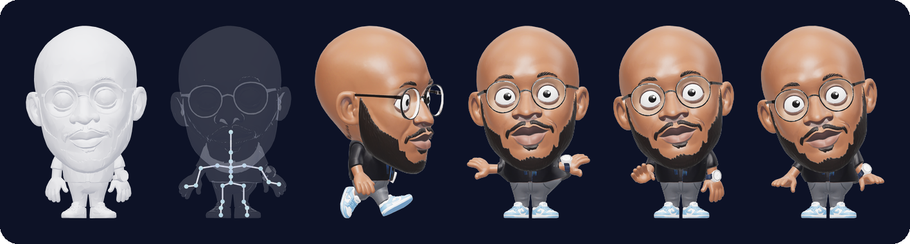

# thefirsthenry

A thumb-sized 3D version of me that lives on my desktop. He walks, waves, shows 16 moods, speaks
out loud and answers questions by looking things up in my own files. His brain is
[Hermes Agent](https://hermes-agent.nousresearch.com), running on my own computer.

**How it fits together**

- `rig/`: the 3D body. A Meshy model with a 23-bone skeleton added by `rig/tools/rig.py`, drawn and animated in the browser with three.js (`rig/henry.js`). No baked animations: walking, waving, moods and the jaw are all code.
- `app/`: the page he lives on and a small Python helper that links the page to Hermes. It listens on this computer only.
- `overlay/`: an Electron window that puts him on top of the whole desktop.
- Retrieval: Hermes searches and reads local files with its tools when a question needs them (agentic retrieval, no vector index), and keeps a small memory file between conversations.

<em>From left: the plain model, the 23-bone skeleton, walking, and three of his 16 moods.</em>

**Not in this repository, on purpose:** the Hermes folder (keys, memory, chat history), my voice recordings and voice model, and any `.env` file. `setup.sh` / `setup.bat` installs Hermes fresh, and `tools/set_key.py` adds your own key.

Built with Claude Code.

## Build your own

You can fork this and have your own tiny buddy running in about 20 minutes. He starts with
my settings and a generic personality, and you then swap in your own body, name and voice.

**You need:** a Mac, Windows or Linux computer with about 3 GB free, Git, and a free Google
Gemini key from https://aistudio.google.com/apikey (treat it like a password).

1. **Fork** this repository with the Fork button at the top of the page, then clone your fork
   into a folder **outside** Desktop and Documents (cloud syncing there causes problems):

       git clone https://github.com/<your-username>/thefirsthenry.git
       cd thefirsthenry

2. **Set up.** This installs Hermes Agent with its official installer (1-2 GB), copies in the
   starting personality from `hermes-data/`, and asks for your key (typing stays hidden).
   - Mac or Linux: `bash setup.sh`
   - Windows: double-click `setup.bat`

3. **Start him.**
   - In a small window: `start.command` (Mac), `start.bat` (Windows) or `./start.sh` (Linux).
   - On top of your whole desktop: `start-overlay.command` or `start-overlay.bat` (needs Node.js).

4. **Give him your own body.** The model in `rig/henry-rigged.glb` is my likeness, so please
   don't use it for your own agent. Either:
   - delete `rig/henry-rigged.glb` and he becomes **Buddy**, a simple stand-in you can recolour
     with `rig/tools/make_buddy.py`; or
   - make a full-body 3D character from your own picture (I used Meshy), give it a skeleton
     with the usual Mixamo bone names plus an optional `Jaw` bone, and save it as
     `rig/henry-rigged.glb`. Check it with `rig/demo.html` first. Note that `rig/tools/rig.py`
     is tuned to the shape of my model, so for a different character use your 3D tool's own
     rigging, or adjust the numbers in the script.

5. **Make him yours.**
   - Name and personality: edit `hermes/SOUL.md`. Keep the "Mood and body tags" part, because
     that is what makes him move.
   - Your own voice (optional): see `voice/README.md`.
   - Letting him read your files (optional): see `extras/full-access-SOUL-section.md`. Only do
     this if you are happy for what he reads to go to your AI service.
   - A different AI service: see "A different brain" in `starter/README.md`.

6. **Keep your private things private.** The `.gitignore` already leaves out `hermes/` (your key,
   memory and chats), your voice files and any `.env`. Don't force-add them, and never paste a
   key into a file that gets uploaded.

Credits and licences for the parts this is built on are in `NOTICE.md`.

## User guide

A tiny 3D Henry who lives on your screen, talks out loud, listens through the mic, shows
moods, walks around, and remembers things about you. His brain is Hermes Agent.

## What is where

| Folder / file | What it is |
| --- | --- |
| `rig/` | The 3D body: `henry-rigged.glb` (the model) and `henry.js` (moves him). See `rig/README.md`. |
| `app/` | Henry's page (`web/index.html`), the helper program that links him to Hermes (`server.py`), the starter (`launch.py`), his settings (`settings.json`) and his personality (`SOUL.md`). |
| `hermes/` | Hermes Agent: its program, settings, memory, skills and chat history. Your key lives in `hermes/.env` and nowhere else. |
| `tools/` | `set_key.py` (puts your key in safely), `pack_up.py` and `restore.py` (moving computers). |
| `start.command` / `start.bat` / `start.sh` | Double-click to start Henry in a small window (Mac / Windows / Linux). |
| `start-overlay.command` / `start-overlay.bat` | Double-click to put Henry on top of your whole desktop. |
| `overlay/` | The see-through desktop window (Electron). `node_modules/` inside it is downloaded, never packed. |
| `setup.sh` / `setup.bat` | Set Henry up on a new computer. See `MOVING.md`. |

## Using him

- Start: double-click `start.command`. A small window opens with Henry in it.
- Type in the box and press Enter, or click 🎤 and just talk. Click 🎤 again to stop listening.
- Pick him up with the mouse and put him anywhere in the window. Tell him "come here" to
  bring him back to the floor.
- He notices you: he watches your pointer, gets curious when it comes close, jumps if you
  swipe past fast, waves if you hover on him, giggles if you poke (quick click) him, walks over
  to where you click, looks at the box while you type, and dozes off if left alone.
- Stop: press Ctrl+C in the Terminal window that opened, or close it.

## Henry on your whole desktop

Double-click `start-overlay.command` (Windows: `start-overlay.bat`). Henry walks along the
bottom of your screen on top of every window. Clicks on empty space go straight through to
whatever is underneath; only Henry and his chat box catch the mouse.

- Drag him anywhere on the screen.
- Hover over him and a small chat box appears beside him. Or press **Cmd+Shift+H**
  (Windows: **Ctrl+Shift+H**) from anywhere to type to him.
- The microphone only works in the normal window (`start.command`), not on the desktop.
- Stop: close the Terminal window, or quit "Electron" from the Dock.

## Settings (`app/settings.json`)

- `"graphics"`: `"low"` (default, for this Mac) or `"high"` (smoother edges and nicer light).
- `"size"`: his height in pixels. 110 is about thumb height.
- `"voice"`: the name of a voice from your computer, or `""` for the default.

Restart Henry after changing them.

## Henry in your voice

Henry speaks in your own voice using Pocket TTS (free, from Kyutai), which runs on this Mac:
your voice never leaves the computer. Files are in `voice/`: your recording (`my-voice.m4a`),
the voice made from it (`my-voice-2m.safetensors`) and test clips in `voice/samples/`.

- In `app/settings.json`: `"my_voice": false` switches back to the computer voice.
- `"voice_model"` / `"voice_file"`: `english_2m_2026-10` with `voice/my-voice-2m.safetensors`
  is fastest (default); `english_7m_2026-10` with `voice/my-voice-short.safetensors` sounds
  better but is slower on this Mac.
- If your voice can't start, Henry quietly uses the computer voice instead.

## His personality

`hermes/SOUL.md` (a copy is kept in `app/SOUL.md`). Edit it in any text editor. It tells
Hermes to start each reply with a mood tag like `[happy]` and to keep replies short and
spoken. Changes apply to new conversations.

## Talking to him from your phone (Tailscale, private to you)

Tailscale makes a private network between only your own devices. Nothing is opened to the
public internet.

1. Install Tailscale on the Mac (https://tailscale.com/download) and sign in. Install the
   Tailscale app on your phone and sign in with the **same** account.
2. In the Tailscale admin page (https://login.tailscale.com/admin/dns), turn on
   **HTTPS Certificates** (needed for the microphone on the phone).
3. With Henry running, open Terminal and type:

       tailscale serve --bg 4750

   It prints an address like `https://your-mac.tailXXXX.ts.net`. Open that on your phone
   (Tailscale switched on). Only devices signed in to your Tailscale can open it.
4. To stop sharing: `tailscale serve reset`.

On a Mac where `tailscale` isn't found in Terminal, use the full path instead:
`/Applications/Tailscale.app/Contents/MacOS/Tailscale serve --bg 4750` (and `... serve reset`).
The sharing stays switched on after a restart; Henry just needs to be running on the Mac.

Never use `tailscale funnel`: that one *does* open things to the public internet.

## What Henry can see

You chose to let Henry look through everything on this Mac (Desktop, Documents, Downloads,
iCloud Drive and so on). He reads files when a question needs them, and he asks before
deleting, moving, sending or changing anything. Hermes blacks out keys and passwords in what
he reads, and `.env` files are marked secret. What he reads is sent to the AI service you connect Hermes to.

- His memory is bigger now: 8,000 characters of his own notes and 5,000 about you
  (`hermes/config.yaml`, `memory:` section).
- To undo all of this: put back `hermes/config.yaml.before-everything` as `hermes/config.yaml`,
  and remove the "Your owner's computer and phone" part of `hermes/SOUL.md`.

## Safety notes

- Hermes and the helper program only listen on this computer (127.0.0.1).
- Hermes' access key never reaches the web page; the page uses a random one-time token
  that other websites cannot read.
- When asked through Henry, Hermes refuses risky computer commands automatically
  (Hermes' "unattended" setting is left on "deny").
